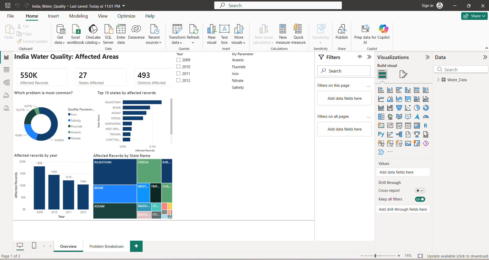

# India Water Quality: Affected Areas

An interactive Power BI dashboard analysing **550,157 water-quality records** across **27 states and 493 districts** in India (2009-2012). It shows which contaminants affect which regions, and how the problem changed over time.



## Key Findings

- **Iron is the dominant problem**, at about 55% of all records. Salinity (~20%) and Fluoride (~18%) follow; Arsenic (~5%) and Nitrate (~2%) are less widespread.
- **Four states account for most affected records:** Rajasthan (131,417), Bihar (92,332), Assam (79,910) and Orissa (68,619).
- **Barmer and Jodhpur (both Rajasthan) are the most affected districts**, with 43,752 and 32,152 records.
- **Affected records fell every year**, from about 180,000 in 2009 to about 104,000 in 2012.

## Dashboard Pages

| Page | What it shows |
|---|---|
| **Overview** | KPI cards (affected records, states, districts), contaminant share (donut), records per year, records per state, state treemap |
| **Problem Breakdown** | State × contaminant matrix, yearly trend by contaminant, top districts |

Both pages have slicers for **Quality Parameter** and **Year**.

## Dataset

| Item | Detail |
|---|---|
| File | `River_Water_Quality.xlsx` (sheet: `IndiaAffectedWaterQualityAreas`) |
| Raw size | 550,242 rows × 8 columns |
| Grain | One row per affected habitation per contaminant per year |
| Columns | State, District, Block, Panchayat, Village, Habitation, Quality Parameter, Year |
| Contaminants | Iron, Salinity, Fluoride, Arsenic, Nitrate |
| Period | 2009 - 2012 |
| Source | _Add source link here_ |

## Data Cleaning (Power Query)

| Step | Action | Result |
|---|---|---|
| 1 | Loaded file into Power Query | 550,242 rows, 8 columns |
| 2 | Checked for blank cells | 0 blanks in all columns |
| 3 | Removed duplicate rows (all 8 columns) | 85 removed, 550,157 rows left |
| 4 | Year: kept last 4 characters, set to whole number | Years 2009 to 2012 |
| 5 | Removed bracket codes from 5 name columns, trimmed spaces | e.g. `EAST GODAVARI(04)` → `EAST GODAVARI` |
| 6 | Checked Quality Parameter values | 5 distinct values |

The Excel file also contains a `Cleaning Log` sheet with these steps.

## DAX Measures

- `Affected Records`: count of affected records
- `States Affected`: distinct count of states
- `Districts Affected`: distinct count of districts

## Tech Stack

- Power BI Desktop
- Power Query (data cleaning)
- DAX (measures)
- Excel (source data)

## Repository Structure

```
├── India_Water_Quality.pbix     # Power BI report
├── River_Water_Quality.xlsx     # Source data + cleaning log
├── images/                      # Dashboard screenshots
└── README.md
```

## How to Use

1. Clone or download this repository.
2. Open `India_Water_Quality.pbix` in [Power BI Desktop](https://powerbi.microsoft.com/desktop/).
3. If prompted, point the data source to your local copy of `River_Water_Quality.xlsx` (Transform data → Data source settings).
4. Use the slicers to filter by contaminant and year.

## Limitations

- Data covers 2009-2012 only; it does not reflect current water quality.
- Counts are affected habitation records, not population affected.
- State names follow the source (e.g. "Orissa" rather than "Odisha").

## Author

**Kavz** · [GitHub](https://github.com/kaviya-s546)
